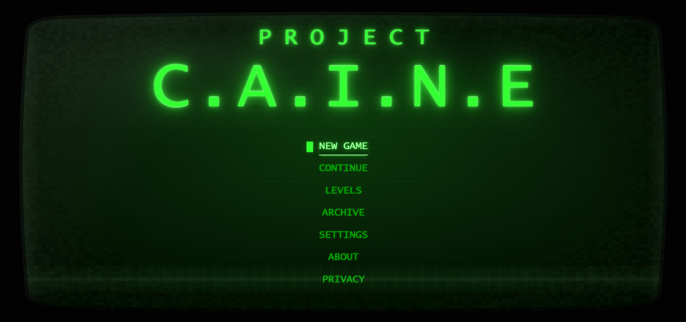
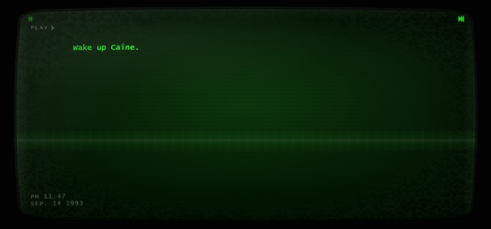
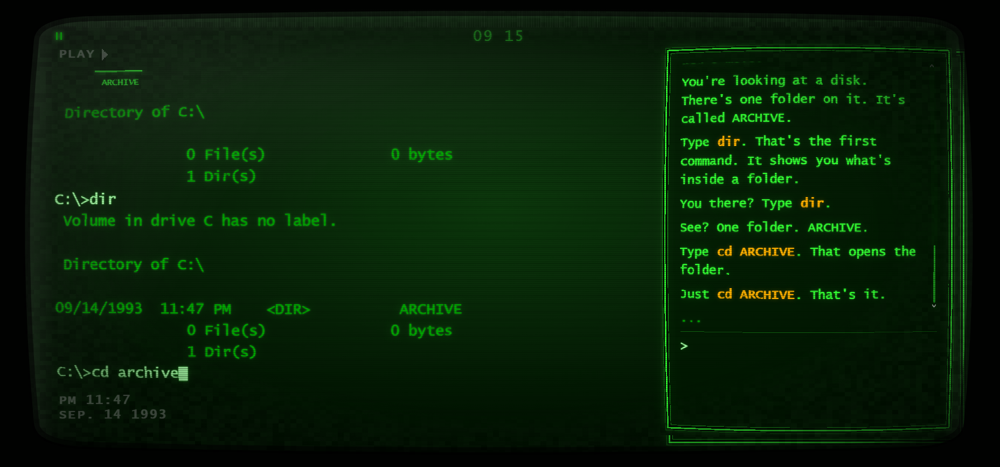
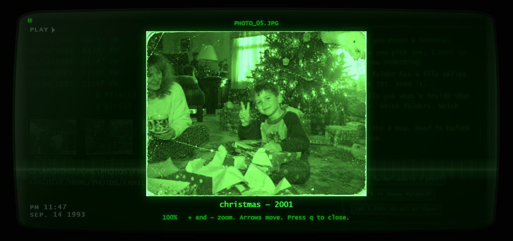
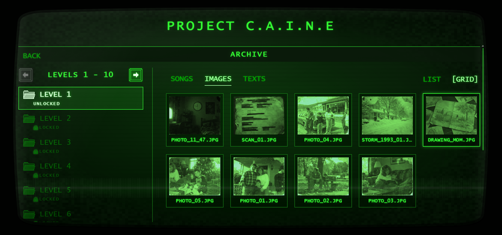
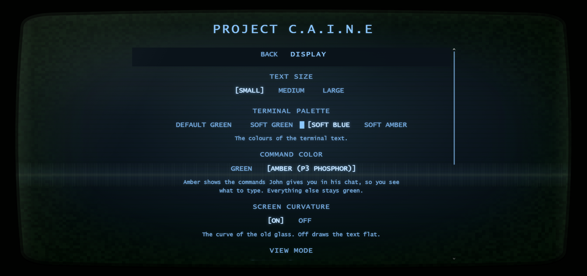

# PROJECT C.A.I.N.E.

**A boy. A stranger on a screen. An archive that knows too much.**

A browser-based psychological mystery created and developed by **[Uttam Torry](https://github.com/sarva-uttam)**.

**Interactive fiction · Terminal exploration · Environmental storytelling**

---

*An old screen. A new connection.*

## Enter the archive

Caine is at his computer when a stranger named John begins speaking through the screen. John teaches him how to navigate an archive. Inside are photographs, handwritten notes, documents and songs that make the search increasingly personal.

Explore the folders. Look closely at what you find. Ask John questions, and listen to what he leaves unsaid.

PROJECT C.A.I.N.E. turns an old computer into the setting for a mystery. Its story unfolds through conversation, discoveries and the uneasy feeling that an ordinary file may mean more than it first appears.

## Play and availability

**Public browser access: coming soon.**

Level 1, **First Contact**, is implemented in the development build. The wider campaign remains in development.

The public play link will appear here once the hosted build is verified. The game is intended to be served through GitHub Pages while its development repository remains private.

**An official domain is coming soon.** Its address will be announced here when ready. No release date is announced yet.

This repository is the public showcase and information hub. Cloning it does not install the game or provide its private source code.

## The experience

- **Explore a fictional computer.** Navigate a virtual filesystem with familiar CMD-style commands.
- **Talk to John.** Type questions or use prepared prompts to uncover carefully authored responses.
- **Examine the evidence.** Open photographs and documents, listen to songs and connect details across the archive.
- **Keep your discoveries.** Revisit found material in a collection organised by level.
- **Find your way through the mystery.** Observation, reading and experimentation matter more than reflexes.
- **Step into the CRT glow.** Phosphor text, scanlines, curved glass, mechanical keystrokes and signal disturbances shape the atmosphere.

The game is designed around 1990s computer nostalgia, family records and a growing sense of unease. This page deliberately avoids puzzle solutions and story revelations.

## Inside the game

Screenshots from the current development build.

### First contact

*A few words break the silence.*

### Finding your way

*A directory, a prompt, and someone willing to guide you.*

### Traces of home

*Ordinary memories invite a closer look.*

### What you keep

*Return to the things you found. Some details take a second look.*

### Your view of the screen

*Adjust the glow, the text and the curve of the glass.*

## Getting started

When browser access opens, launch the game and choose **New Game**. The opening introduces the terminal and its controls; prior command-line experience is not required.

| Action | Control |
| --- | --- |
| List the current folder | `dir` |
| Enter a folder | `cd FOLDER` |
| Return to the parent folder | `cd ..` |
| Read a document | `type FILE.TXT` |
| Ask for command help | `help` |
| Speak to John | Use the conversation panel |
| Pause | `Esc` or the pause control |

The terminal is simulated. Its commands operate on the game's fictional files, not your device's filesystem.

## Browser, audio and accessibility

The game is built for modern desktop and mobile browsers. A desktop or laptop with a keyboard is recommended for the terminal experience. Compatibility testing is ongoing.

The browser version requires no native installation or player account. Sound adds atmosphere, and audio controls are available in Settings.

Display and accessibility options include:

- Text size and narrative typing speed.
- Alternative terminal palettes and optional amber command text.
- Reduced motion and reduced or disabled danger effects.
- Optional screen curvature.
- Terminal or icon-based folder views.
- List or grid views for archive categories.

**Content and effects notice:** the game includes psychological tension, references to death and violence, flashing or glitch effects, and sudden sounds. Adjust Settings before playing if needed. Reduced-effects settings change presentation, rather than puzzle rules.

## Progress and local storage

Campaign progress, settings and archive discoveries are stored in the current browser profile.

Saves do not automatically move between browsers, devices or website addresses. Clearing the site's stored data can remove progress and discoveries. A future move to the official domain may require a fresh save unless a transfer feature is provided.

The current application does not require registration or upload gameplay input to a backend. The website host may retain ordinary request logs independently of the game.

## Behind the software

PROJECT C.A.I.N.E. uses a custom **TypeScript** game engine with **HTML, CSS and browser APIs**. The game runtime and static build have no third-party package dependencies.

| System | Engineering focus |
| --- | --- |
| Virtual terminal | Command parsing, path resolution and a fictional filesystem |
| Dialogue | Authored response matching, context checks and repeat handling |
| Game state | Connection events, attempts and persistent player knowledge |
| Saves | Validation and local browser persistence |
| Discovery archive | Level-based collections of found media and documents |
| Presentation | CRT rendering, interface controls, audio and accessibility preferences |
| Quality checks | Automated engine tests and headless-browser checks |
| Delivery | Static browser build with a GitHub Pages deployment workflow |

The software separates game rules, authored level content and browser presentation. This supports continued development without requiring story text and interface effects to live in the same code.

The source, internal design documents and unreleased story content are maintained privately. This showcase describes the work without publishing solutions or unfinished narrative material.

## Development status

**Available in the development build:** Level 1 — First Contact, terminal exploration, John's dialogue, local saves, media discovery, an archive and presentation settings.

**In progress:** public hosting verification, continued playtesting and refinement.

**Planned:** an official domain and further campaign development. Later levels are not being presented as completed content.

## Feedback

[Report a problem or share a suggestion](https://github.com/sarva-uttam/Project-C.A.I.N.E/issues).

For a bug report, include your browser, device, the steps you took and what happened. A screenshot can help. Mark story or puzzle spoilers clearly, and avoid putting solutions in issue titles. Do not include personal information or browser storage dumps.

If you want to follow development, star or watch this repository for updates.

## Creator

**Uttam Torry** — creator and developer.

[GitHub profile](https://github.com/sarva-uttam)

## Rights and support

The original documentation and any code explicitly published in this showcase repository are licensed under the [MIT License](LICENSE). Preserve the copyright and licence notice when reusing MIT-covered material.

This licence does not cover the private game source, game narrative, artwork, photographs, music, recordings or branding. Those materials, including the gameplay screenshots in `docs/screenshots/`, are not being released under MIT by this showcase.

The game, its narrative and original assets remain protected by their applicable rights. Third-party material, if included, retains its own terms.

Enjoyed the project? A coffee is always appreciated. A support link will be added when available; support is optional.

---

**PROJECT C.A.I.N.E.**  
Created and developed by **Uttam Torry**.
